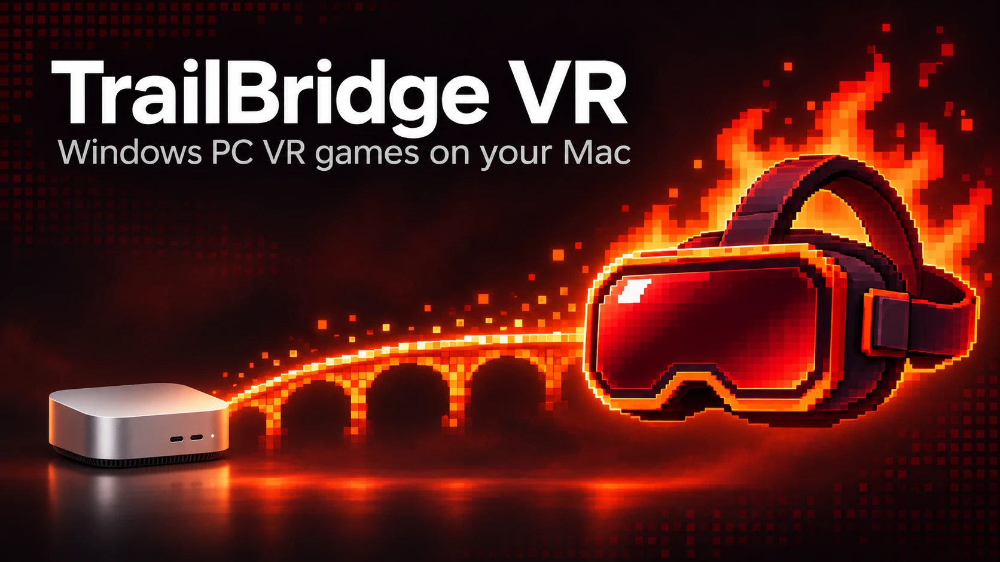
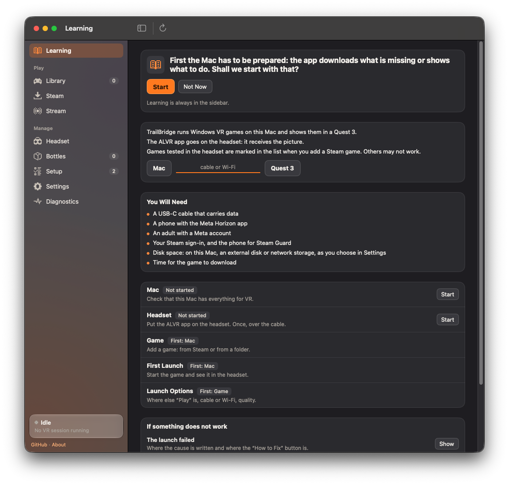
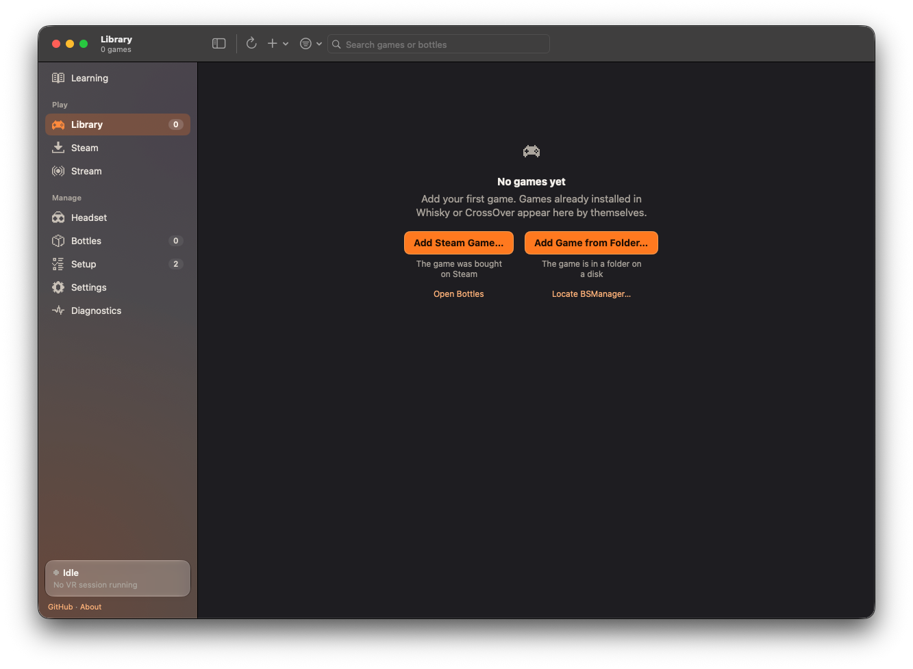
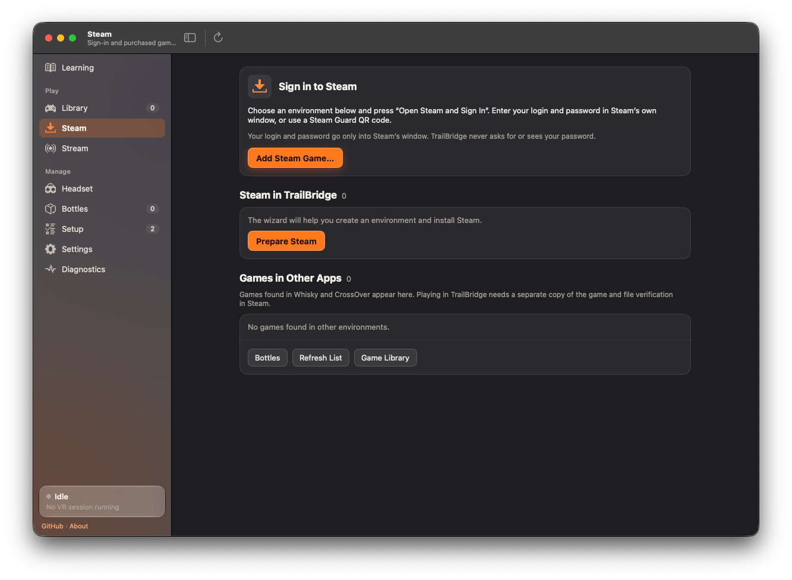
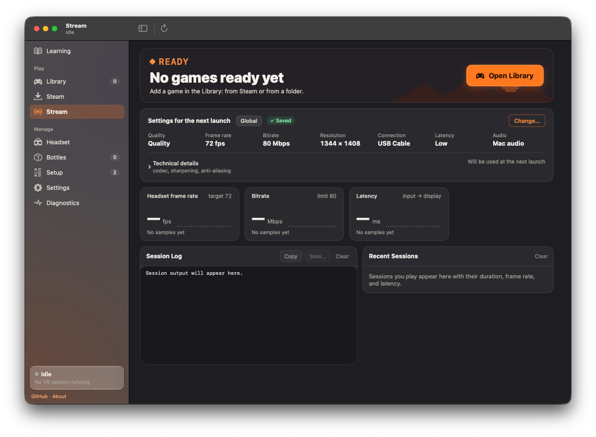
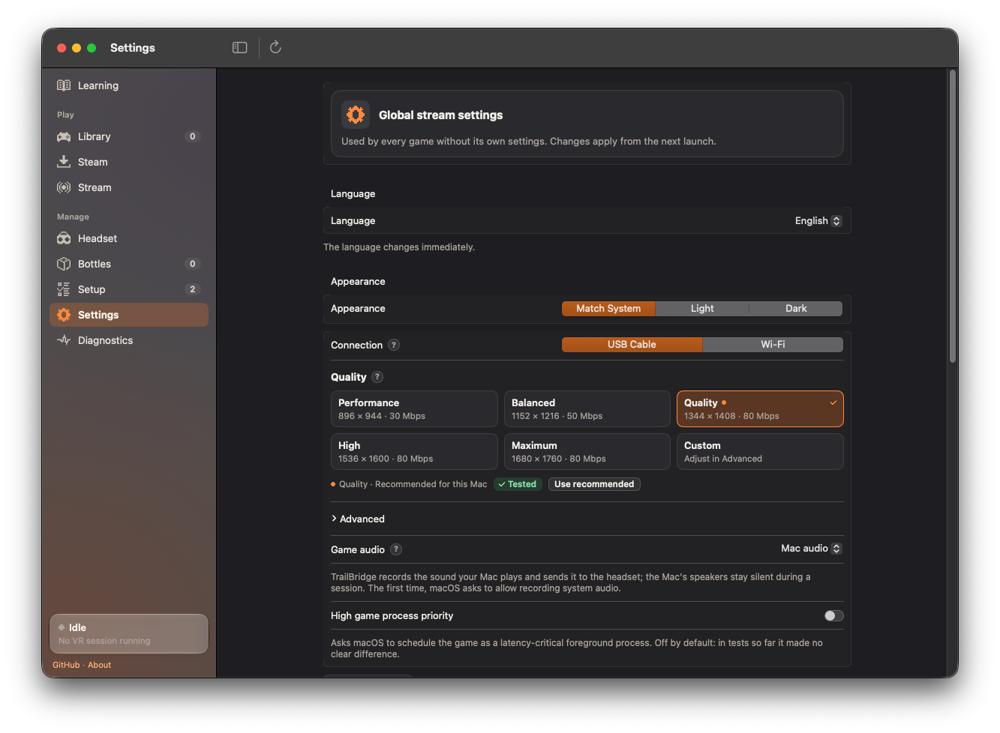

<p align="center">
  
</p>

<p align="center">
  <a href="https://github.com/abgitdev/TrailBridge-VR/releases/latest"></a>
  <a href="https://github.com/abgitdev/TrailBridge-VR/releases"></a>
  <a href="https://github.com/abgitdev/TrailBridge-VR/actions/workflows/ci.yml"></a>
  <a href="LICENSE"></a>
  
</p>
<p align="center">
  
  
  
  
  
</p>
<p align="center">
  <a href="#tested-setup"></a>
  
  
  
  
  <a href="https://www.virustotal.com/gui/file/1da375d33511d213dd290f6f663b6a9ad32fa441f2bbd7af9e53d7c5a7e0d744"></a>
  <a href="CONTRIBUTING.md"></a>
</p>

<h3 align="center">Play Windows PC VR games on an Apple Silicon Mac with a Meta Quest headset.</h3>

<p align="center">
  <a href="https://github.com/abgitdev/TrailBridge-VR/releases/latest"><b>Download the DMG</b></a> ·
  <a href="#install">Install</a> ·
  <a href="#tested-setup">Tested setup</a> ·
  <a href="#build-from-source">Build from source</a> ·
  <a href="CONTRIBUTING.md">Contribute</a>
</p>

TrailBridge VR runs Windows VR games under Wine on your Mac and streams them to the headset
over a USB cable or Wi‑Fi. A patched DXMT translates Direct3D 11 to Metal, the project's own
OpenXR runtime talks to the game, and a native macOS streamer sends the picture to the ALVR
client on the headset. The app is free and open source, with no subscriptions, and it is built
on [BasaltVR](https://github.com/frenchbaguetteman/BasaltVR).

> [!WARNING]
> TrailBridge VR is experimental. It was tested on one Mac with one headset (see
> [Tested setup](#tested-setup)); other Macs, headsets and games may not work. The app is not
> signed by Apple.

## Features

- **Add Steam Game**: creates a Wine environment, installs the official Steam client, waits for
  Steam's downloads and updates, and adds the game to the Library. When Steam hangs, the app
  restarts it.
- **Add Game from Folder**: copies a Windows game from a folder on any disk into its own
  environment and leaves the folder unchanged.
- **OpenVR and OpenXR games**: OpenVR games run through OpenComposite, which the app downloads on
  request; OpenXR games run directly.
- **Picture quality**: presets from Performance to Maximum with a recommendation for your Mac,
  HEVC or H.264, per-eye sizes up to 3072 × 3280, and 72, 90 or 120 Hz.
- **USB or Wi‑Fi**: reconnect the headset without restarting the game; over Wi‑Fi the bitrate
  follows the network.
- **Game audio** from the Mac itself (macOS 14.2 or newer) or through BlackHole.
- **Guided setup**: a Learning guide from a new Mac to the first game, and a Setup page that
  downloads Wine, the ALVR client and Android platform tools with checksums.
- **Diagnostics that stay on the Mac**: each session keeps an excerpt of the game's own log with
  personal data replaced, and the session log hints at known causes, such as a missing GStreamer.
- **Clean removal**: one button deletes everything the app stored on the Mac.
- **10 languages**: English, Russian, Ukrainian, German, Spanish, French, Italian, Polish,
  Japanese and Korean. English and Russian are reviewed; the others are machine translations.

## Screenshots

<p align="center">
  
</p>
<p align="center">
  
  
</p>
<p align="center">
  
  
</p>

## Tested setup

| | |
|---|---|
| Mac | Mac mini M4 with 32 GB of memory, macOS 27 |
| Headset | Meta Quest 3, 512 GB, ALVR client 20.14.1 |
| Connection | USB cable and Wi‑Fi |
| Games | Bought on Steam and installed through the official Steam client, and added from a game folder without Steam |

| Game | Runs through | Notes |
|---|---|---|
| BRUTALISTICK VR | OpenComposite (OpenVR) | |
| Blood Trail | OpenComposite (OpenVR) | Walking direction follows the controller setting; running is not available on controllers. |
| VTOL VR | OpenComposite (OpenVR) | TrailBridge VR switches the game to one render pass per eye; without it the right eye stays black. |
| BONELAB | The game's own OpenXR | |
| Blade & Sorcery | OpenComposite (OpenVR) | |
| Electrician Simulator VR | The game's own OpenXR | Its intro video needs GStreamer, which the Setup page checks for. |
| Tactical Assault VR | The game's own OpenXR | |
| The Elder Scrolls V: Skyrim VR | OpenComposite (OpenVR) | |

Not tested: Macs with 8 GB or 16 GB of memory, other Mac models and other headsets. TrailBridge
VR does not promise stable operation on them. Other games may work but are not verified.

## Install

1. Download `TrailBridge-VR-<version>-macos-arm64.dmg` from
   [Releases](https://github.com/abgitdev/TrailBridge-VR/releases/latest). Each release lists
   the file's SHA-256 and a VirusTotal report ([0.2.3](https://www.virustotal.com/gui/file/1da375d33511d213dd290f6f663b6a9ad32fa441f2bbd7af9e53d7c5a7e0d744): no security vendor flagged it).
2. Optionally check the file: `shasum -a 256 ~/Downloads/TrailBridge-VR-*.dmg` must print the
   published SHA-256.
3. Open the DMG and drag **TrailBridge VR** to **Applications**.
4. Open the app. It is not signed by Apple, so macOS blocks the first start: open
   **System Settings › Privacy & Security**, click **Open Anyway** next to TrailBridge VR and
   confirm. This is needed once.
5. If the Mac has no Rosetta 2 yet, run this in Terminal:

   ```sh
   softwareupdate --install-rosetta --agree-to-license
   ```

6. Follow **Learning** in the app. Choose the data folder (this Mac, an external disk or network
   storage) before the app downloads Wine 11.10 (about 190 MB) and your games.

## Requirements

- A Mac with Apple Silicon and macOS 14 or newer, with Rosetta 2. Intel Macs are not supported.
- Games that play videos need [GStreamer 1.28.1](https://gstreamer.freedesktop.org/data/pkg/osx/1.28.1/gstreamer-1.0-1.28.1-universal.pkg),
  the package recommended for Wine 11.10. Install it with an administrator account, for all
  users of this Mac.
- A Meta Quest headset in developer mode. Only the Quest 3 is tested.
- Your own Steam account and games you bought, or Windows VR games you own in a folder.
- Free space on the disk with the data folder: about 720 MB for Wine, plus Steam and the games.

Known limits: the OpenXR runtime is not conformant; per-eye sizes above 1680 × 1760 need a
strong Mac and a light game; Steam under Wine sometimes freezes (use **Restart Steam** on the
Steam page); the headset's microphone is not passed to the Mac.

## How it works

```
Windows VR game ──► [OpenComposite] ──► OpenXR runtime ──► DXMT fork        (inside Wine)
 (D3D11, PE)         OpenVR games only   (Windows DLL)      (D3D11 → Metal)
                                             │                    │
                              control socket │                    │ IOSurface per eye
                                             ▼                    ▼
                     basalt-streamer:  Metal stereo compose ──► VideoToolbox HEVC/H.264
                                             │                              (native macOS)
                                             ▼
                     ALVR transport (USB or Wi-Fi) ──► Quest headset
                     ◄── head/controller tracking, buttons, haptics, statistics ──
```

[docs/ARCHITECTURE.md](docs/ARCHITECTURE.md) describes the design in detail.

## Build from source

You need Xcode with the Metal toolchain, CMake, LLVM-MinGW, Meson and Ninja.

```sh
git clone https://github.com/abgitdev/TrailBridge-VR.git
cd TrailBridge-VR
./scripts/trailbridge-dev.zsh make doctor-dxmt        # check the tools
./scripts/trailbridge-dev.zsh runtime/scripts/build-dxmt-fork.zsh
./scripts/trailbridge-dev.zsh make dxmt-test          # pinned Wine, runtime and graphics tests
./scripts/trailbridge-dev.zsh make check              # repository checks and Swift tests
./scripts/trailbridge-app.zsh                         # builds .local/apps/TrailBridge VR.app
./scripts/trailbridge-dev.zsh make release            # builds the DMG in .local/dist
```

Run every development command through `scripts/trailbridge-dev.zsh`: it keeps caches,
temporary files and the app's data inside `.local/` in the checkout. The first DXMT build
compiles LLVM and takes tens of minutes. `make help` lists all targets.

| Document | Covers |
|---|---|
| [Management app](docs/MANAGEMENT.md) | The app's screens and workflow |
| [Bottles and launch profiles](docs/BOTTLES.md) | `basaltctl`, environments, OpenComposite and launching games |
| [Streamer](docs/STREAMER.md) | `basalt-streamer` over USB and Wi‑Fi, audio and stream settings |
| [OpenXR runtime](runtime/README.md) | What the runtime implements and how it is tested |
| [Architecture](docs/ARCHITECTURE.md) | System design and BasaltVR's milestone history |
| [DXMT interop](docs/DXMT-INTEROP.md) | The D3D11 → Metal → IOSurface handoff and the DXMT fork |

## Contributing

Bug reports, compatibility reports for games and pull requests are welcome. Read
[CONTRIBUTING.md](CONTRIBUTING.md) and use the issue forms. Setup help: [SUPPORT.md](SUPPORT.md).
Report security problems privately as described in [SECURITY.md](SECURITY.md). Leave out
credentials, device serial numbers and home-folder paths; the app's diagnostic report removes
them before you share it.

## Credits

- [BasaltVR](https://github.com/frenchbaguetteman/BasaltVR): the OpenXR runtime, the DXMT fork,
  the streamer and the app that TrailBridge VR builds on.
- [DXMT](https://github.com/3Shain/dxmt) by Feifan He: Direct3D 11 on Metal.
- [Wine](https://www.winehq.org) and the [macOS Wine builds by Gcenx](https://github.com/Gcenx/macOS_Wine_builds).
- [ALVR](https://github.com/alvr-org/ALVR): the headset client and its streaming protocol.
- [OpenComposite](https://znix.xyz/OpenComposite/): OpenVR games on OpenXR.
- [Khronos OpenXR SDK](https://github.com/KhronosGroup/OpenXR-SDK) and
  [LLVM-MinGW](https://github.com/mstorsjo/llvm-mingw).

## License

TrailBridge VR is released under the [MIT License](LICENSE), like BasaltVR, whose copyright
notice the license keeps. Components that the app contains or downloads keep their own licenses:
see [THIRD_PARTY_NOTICES.md](THIRD_PARTY_NOTICES.md) and [LICENSES](LICENSES). TrailBridge VR
does not include, download or unlock games, and it never asks for store credentials. It is an
independent project, not affiliated with or endorsed by the BasaltVR authors, Apple, Meta, Valve
or the game developers; their names are trademarks of their owners.

<p align="center">
  <a href="https://ko-fi.com/abgitdev"></a>
</p>
